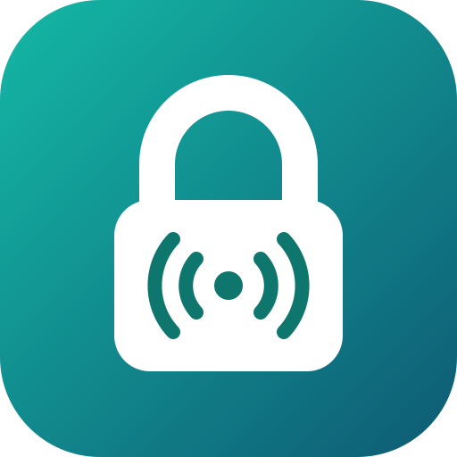

# Kalloq

Llamadas de voz 1 a 1 cifradas de extremo a extremo, entre teléfonos.
*End-to-end encrypted 1:1 voice calls between phones.*

- Sin correo ni número de teléfono: usuario + contraseña + código de recuperación.
- Amigos solo por UUID (QR o enlace).
- Llave por contacto automática, o verificada en persona escaneando un QR.
- El servidor nunca puede escuchar las llamadas.

| Carpeta | Contenido |
|---|---|
| `apps/core/` | Criptografía compartida en C++ (Android vía JNI, iOS en el futuro) |
| `apps/server/` | Servidor de señalización en C++ (`sc-server`) — [protocolo](docs/PROTOCOLO.md) |
| `apps/android/` | App Android (Kotlin, Jetpack Compose) |
| `deploy/` | Configuración de nginx, coturn y systemd |
| `docs/` | [Arquitectura](docs/ARQUITECTURA.md) |

Estado: fases 0–5 listas: servidor en producción (`wss://call.l8.nz/ws`) y app Android con cuentas, código de recuperación, contactos por QR/enlace (con nombre propio en cada teléfono), llaves Ed25519 fijadas (TOFU), ES/EN, llamadas de voz WebRTC (silenciar, altavoz, Bluetooth) con cifrado de extremo a extremo (Noise KKpsk2) verificación en persona por QR, y push FCM para recibir llamadas con la app cerrada. Siguiente: ConnectionService/Telecom y fase 6 (endurecimiento).

## Licencia

[AGPL-3.0](LICENSE)
